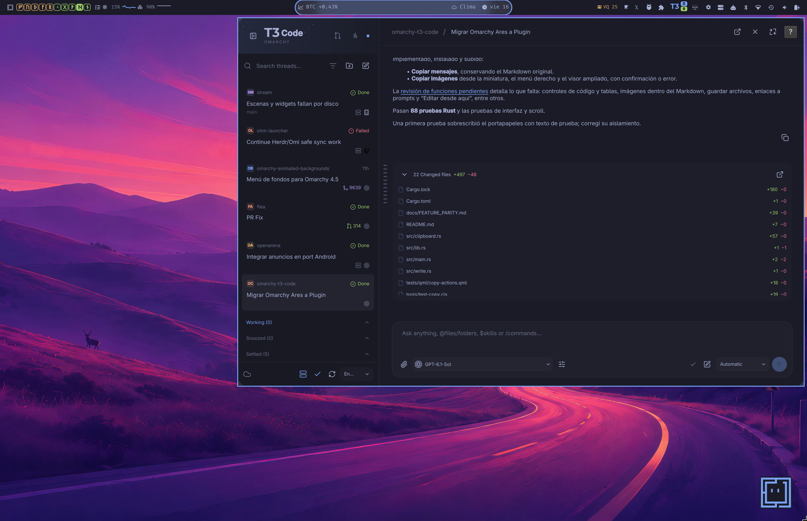
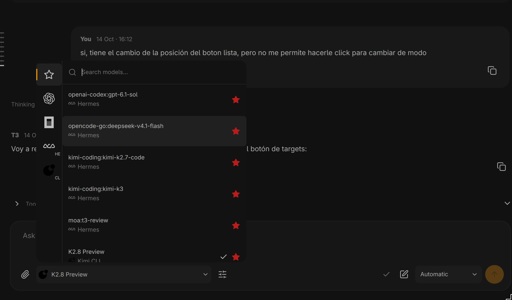
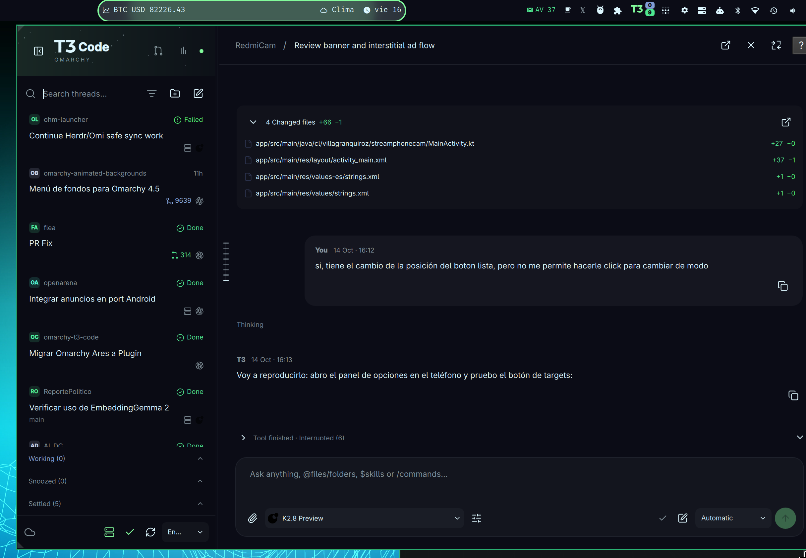
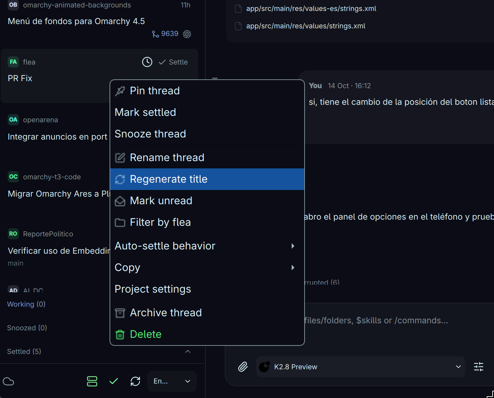
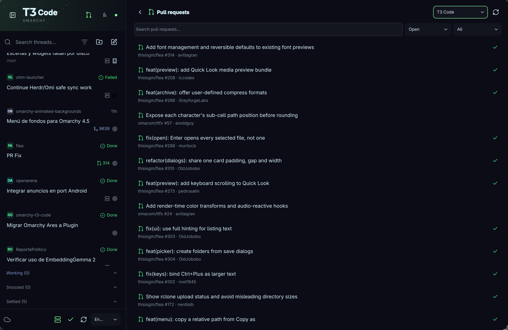

# Omarchy T3 Code

**T3 Code from your Omarchy bar. A lightweight QML interface with a Rust backend.**



| Models and favorites | Live chat and file changes |
| --- | --- |
|  |  |
| **Thread actions** | **Pull requests** |
|  |  |

Follow local and remote coding sessions, write prompts, attach files and respond
to questions without keeping the official T3 desktop GUI open. The panel uses
your Omarchy theme and inherits T3's connections, models and favorites.

## Highlights

- Live messages, contextual work indicators, tasks, queues and changed files.
- Durable drafts, expanded prompt editor, mentions, skills and commands.
- Image/file/HTML previews inside the panel; copy messages and images.
- Thread actions, branch/PR badges, conversation minimap and a PR browser.
- Subscription usage bars and work/ready/input badges on your desktop bar.
- Resizable layout, keyboard navigation, smooth scrolling and **20 languages**.
- Native headless server controls: keep working locally or over your remote connections.

## Install

Requires **Omarchy's Quickshell shell/plugin manager** and **T3 Code installed
and opened at least once**. Run as your desktop user:

```sh
curl -fsSL https://raw.githubusercontent.com/avillagran/omarchy-t3-code/main/install.sh | bash
```

The [installer](install.sh) installs build and preview dependencies through
Pacman, compiles the plugin, enables its bar widget and sets up Super+Enter on
Omarchy's Lua configuration. It reuses an existing T3 server or starts the native
headless service when stopped. Your T3 connections and data stay in place.
The same command updates a clean Git installation. It may request your sudo
password and restarts the Omarchy shell when finished.

## Use

Click **T3** in the status bar. **Super+Enter** sends; **Enter** inserts a newline.
Use the header buttons for subscription usage and pull requests, and right-click
a thread for its actions. **F1** opens keyboard help.

Set up local and remote connections in T3 Code; the plugin inherits them. If the
official GUI owns the server, close it and use the sidebar's start button to run
headless. The plugin does not stop a GUI-owned server.

Some T3 features are still being ported, and the PR view is currently read-only.
See the [feature parity checklist](docs/FEATURE_PARITY.md).

## Development

Build instructions, architecture, the shared Rust library for Omi, keyboard
integration and validation commands live in the [development guide](docs/DEVELOPMENT.md).

## Credits

Evolved from [Omarchy Ares](https://github.com/avillagran/omarchy-ares), inspired by
[T3 Code](https://github.com/pingdotgg/t3code), with [Lucide](https://lucide.dev)
icons. Independent community project. [MIT License](LICENSE) ·
[Asset attribution](ui/assets/README.md).
